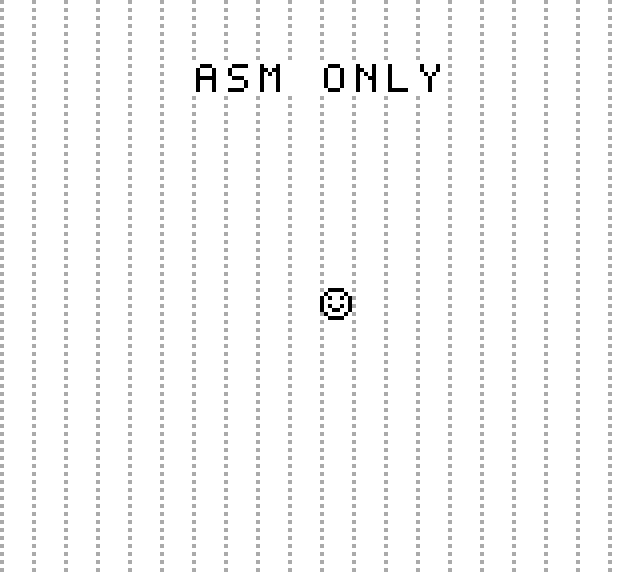

# GameboyASM

A monochrome Game Boy emulator written entirely in **x86-64 assembly** for **Linux**.
No libc, no SDL, no graphics or input libraries, no dynamic loader — just raw
syscalls, a static ELF, and the kernel.



## Build and run

Requirements: Linux x86-64, GNU Binutils (`as`, `ld`), and `make`.

```sh
make
./build/gameboy build/demo.gb
```

The demo displays `ASM ONLY` and a sprite you can move around. It needs an
ANSI terminal with 256 colors and at least **80×37** cells; each character cell
averages a 2×4 block of Game Boy pixels (`--dump` keeps every pixel).

| Key                  | Game Boy button            |
| -------------------- | -------------------------- |
| W / A / S / D        | Up / Left / Down / Right   |
| J / K                | A / B                      |
| U / I                | Select / Start             |
| Q or Ctrl+C          | Quit                       |

Terminals report presses and repeats, not releases, so each press holds the
button for about 200 ms. Terminal state is restored on normal exit, Ctrl+C,
SIGTERM, SIGHUP, and SIGTSTP.

Run your own supported ROM:

```sh
./build/gameboy /path/to/game.gb
```

Headless run, optionally saving the last rendered frame:

```sh
./build/gameboy build/demo.gb --frames 120 --dump build/frame.pgm
```

`--frames N` runs exactly N periods of 70,224 emulated T-cycles (rounded up to
the next complete instruction), without real-time pacing, and writes serial
output to stdout. The demo prints `ASM OK`. `--dump` writes a binary 160×144
grayscale PGM on exit.

## What works

- All 245 legal SM83 opcodes and all 256 CB-prefixed opcodes, with flags and
  conditional timing. Illegal opcodes report opcode and PC.
- Register pairs, stack, signed SP arithmetic, DAA, delayed EI, interrupt
  priority, RETI, HALT, and the HALT bug.
- ROM, VRAM, work RAM, echo RAM, OAM, HRAM, and memory-mapped I/O.
- ROM-only cartridges (type `00`, 32 KiB) and MBC1 (types `01`–`03`, up to
  2 MiB) with ROM and external RAM banking.
- Divider, falling-edge TIMA clock, timer reload delay, joypad, serial, and
  interrupts.
- Scanline rendering: tiles, scrolling background, window, palettes, 8×8 and
  8×16 sprites, flips, transparency, DMG sprite priority, STAT/VBlank.
- OAM DMA, and real-time pacing with a monotonic clock.

## What does not

This is an early emulator, not a claim of full hardware or game compatibility.
Commercial games and external test suites have not been verified.

- No audio, Game Boy Color, Super Game Boy, MBC2/3/5, RTC, link cable, save
  states, or battery saves.
- No boot ROM: execution starts at `0100` from an approximate DMG post-boot
  state; boot-logo VRAM and header validation are not reproduced.
- Bus accesses happen at instruction boundaries, so timing is not accurate for
  individual bus operations, DMA contention, or all timer races.
- OAM DMA copies instantly; VRAM/OAM access restrictions and the OAM bug are
  not modeled. LCD mode 3 is a fixed 172 dots.
- STOP behaves as a halted CPU while peripherals keep running.

## Tests

```sh
make test
```

The tests are native assembly linked against the same core:

- 1,048,576 ALU combinations checked against a wide-arithmetic reference.
- 131,072 CB instruction cases: every opcode and operand, both carry inputs.
- Legality and cycle counts for every base opcode, plus focused coverage of
  loads, stack, CALL/RET/RST, DAA, signed offsets, flags, interrupt priority,
  EI delay, RETI, and the HALT bug.
- ROM protection, echo RAM, MBC1 banking, external RAM enable, DMA, timer
  edges and reload, and graphics timing, tiles, window, transparency, sprite
  priority, and flips.
- End-to-end demo run, serial output, frame size, and ELF checks that the
  binary has no dynamic interpreter or shared-library dependencies.

Input handling was verified in a pseudo-terminal: movement changed the dumped
frame, quitting exited cleanly, and terminal settings were restored. No
external test-ROM suite has been run yet.

## Source map

| File                       | Responsibility                                    |
| -------------------------- | ------------------------------------------------- |
| `src/main.s`               | Entry point, argument parsing, emulation loop     |
| `src/state.s`              | Registers, memory, cartridge state, reset         |
| `src/cpu.s`                | SM83 decoding, arithmetic, stack, interrupts      |
| `src/memory.s`             | Memory bus, MBC1, timers, serial, joypad, DMA     |
| `src/ppu.s`                | LCD timing and scanline renderer                  |
| `src/linux.s`              | Syscalls, ROM loading, terminal, pacing, dumps    |
| `roms/demo.s`, `roms/gb.inc` | Original demo ROM and SM83 assembler macros     |
| `tests/tests.s`            | Assembly regression tests                         |

GNU assembler Intel syntax throughout. Functions preserve RBX, RBP, and
R12–R15; other general registers are scratch. The CPU step returns T-cycles in
EAX; `hardware_tick` takes them in EDI. Bus reads take an address in EDI and
return a byte in EAX; writes take EDI and ESI. Modules are assembled together
through `.include`, with no external symbols.

The demo ROM uses small GNU assembler macros (`roms/gb.inc`) instead of a
Game Boy toolchain, so the whole project builds with binutils and make.

## References

Follows the CPU → memory → tiles/maps → interrupts → sprites approach from
[CTurt's Cinoop article](https://cturt.github.io/cinoop.html); an original
implementation, not a source translation.

Hardware details were checked against Pan Docs:
[instructions](https://github.com/gbdev/pandocs/blob/master/src/CPU_Instruction_Set.md),
[interrupts](https://github.com/gbdev/pandocs/blob/master/src/Interrupts.md),
[timer quirks](https://github.com/gbdev/pandocs/blob/master/src/Timer_Obscure_Behaviour.md),
[rendering](https://github.com/gbdev/pandocs/blob/master/src/Rendering.md),
[OAM](https://github.com/gbdev/pandocs/blob/master/src/OAM.md), and
[MBC1](https://github.com/gbdev/pandocs/blob/master/src/MBC1.md).

Next milestone: pass [Blargg's CPU and timing ROMs](https://github.com/retrio/gb-test-roms),
then improve bus timing and the PPU.
